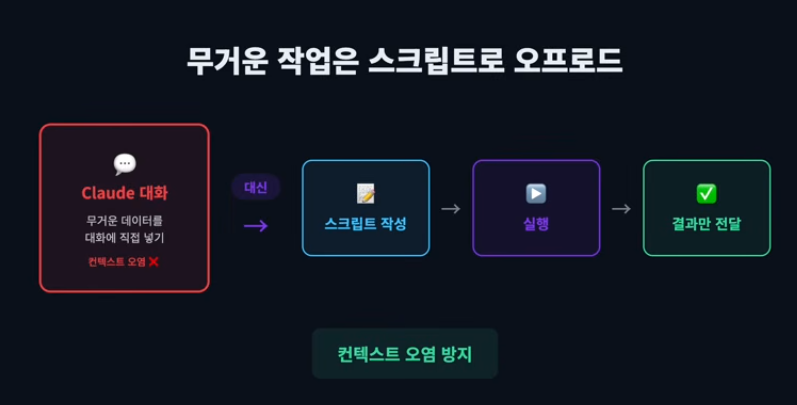

# 컨텍스트 관리의 핵심 (Context Management)
- claude code에서 context는 王이다.

## Second Brain & /memory 구축
- Claude와 작업하면서 배운 것, 새로운 패턴, 해결책, 의사 결정 이유 등을 로컬 마크다운 파일에 저장
    - MEMORY.md = Second Brain, 프로젝트의 기관 기억(institutional memory)
    - 매 세션 시작 시 해당 파일이 자동으로 로드된다.(이전 학습 내용 바로 활용 가능)
- `/memory`로 <u>**Second Brain**</u> 구축 (개인 메모리)
- `/memory` 명령으로 Claude가 작업하면서 자동으로 학습한 내용을 확인 및 편집할 수 있다.(자동 메모리 시스템 관리)
- 저장 위치 : `~/.claude/projects/<project>/memory/MEMORY.md` → 매 세션 시작 시 처음 200줄 자동 로드
- `"기억해줘"`라고 말하면 저장, `/memory`로 확인 가능
- 사용 구분
    - 개인 메모리 → `/memory`
    - 팀 공유 지식 → `claude.md`에 작성

## Lazy Loading (계층적 컨텍스트) - claude.md 참조 구조
- context를 언제 어떻게 불러올 것인가?
- `claude.md`에 모든 정보를 넣으면 매 세션마다 수천 토큰이 낭비된다.
- 따라서 참조만 두고, 상세 내용은 별도 파일로 분리해야 한다.
<details>
<summary>BAD CASE - 모든 내용을 claude.md에 직접 작성(다 때려 넣는다.)</summary>

```md
# CLAUDE.md (나쁜 예)
## API 엔드포인트
- POST /api/auth/login - 로그인...
- POST /api/auth/register - 회원가입...
- GET /api/users/:id - 유저 조회...
- ... (50개 더)
```
</details>

<details>
<summary>GOOD CASE - CLAUDE.md에는 규칙과 한 줄짜리 참조만, 상세 내용은 별도 파일로 분리</summary>

```md
# CLAUDE.md (좋은 예)
## 프로젝트 문서
- API 스펙: @docs/api-spec.md
- DB 스키마: @docs/db-schema.md
- 인증 설계: @docs/auth.md
- 코딩 컨벤션: @docs/conventions.md
```
</details>

- **`Lazy Loading`** : Claude는 필요할 때만 해당 파일을 읽는다.

> **💡 IMPORTANT**
> - root의 CLAUDE.md가 커지는게 걱정된다면 폴더별로 CLAUDE.md를 따로 만들면 된다.
> - 폴더별 CLAUDE.md : `src/auth/CLAUDE.md`, `src/payments/CLAUDE.md`처럼 폴더별로 분리하면 Claude가 해당 폴더 작업 시에만 해당 CLAUDE.md를 읽어 컨텍스트 bloat을 방지한다.

## 컨텍스트 윈도우 관리
- `핵심 원칙 → 한 세션 = 한 피처`
    - 하나의 세션에서 여러 기능을 연달아 구현하면 안 된다.
    - 신선한 컨텍스트가 부풀어진 컨텍스트보다 항상 낫다.
    - ```md
        실전 워크플로우(터미널을 여러 개 열어서 아래와 같이 하는 것을 추천)
        1. Plan Mode에서 전체 작업을 설계하고 단계를 나눈다.
        2. /clear 또는 새 세션을 연다.(컨텍스트 완전 초기화)
        3. Plan의 첫 번째 단계만 구현한다.
        4. 완료되면 다시 /clear → 다음 단계로
        * 핵심 : plan을 짜는 세션과 구현을 하는 세션을 분리하는 것
        ```

## MCP 토큰 모니터링
- MCP를 여러개 연결하면 도구 설명만으로도 토큰을 크게 소비한다.
- 따라서 `/context`로 주기적으로 확인하고 안 쓰는 MCP는 `/mcp`에서 비활성화해야 한다.
```md
[토큰 절약 팁]
- Notion, Linear 같은 MCP는 도구 설명이 매우 크다.
- 자주 쓰는 기능만 골라서 커스텀 MCP를 래핑하면 토큰 절약 + 응답 품질 향상
```

## Mermaid 아키텍처 정리
- `claude.md`에 `Mermaid 다이어그램`으로 아키텍처를 정리하면 Claude가 프로젝트 구조를 한눈에 파악한다.
- `TIP` - 별도 파일(`docs/architecture.md`)에 정리하고 `claude.md`에서 `@docs/architecture.md`를 참조하게 하자
```md
graph LR
    A[클라이언트] --> B[API 게이트웨이]
    B --> C[인증 서비스]
    B --> D[주문 서비스]
    D --> E[결제 서비스]
    D --> F[재고 서비스]
```

## 무거운 작업은 스크립트로 오프로드
- 무거운 데이터 처리를 <u>대화 안에서 시키면</u> 컨텐스트가 오염
- Cladue에게 무거운 작업에 대한 스크립트를 작성하게 하고 그것의 결과만 돌려줘서 Claude가 다음 작업을 할 수 있게한다.
* **핵심** : 무거운 데이터는 스크립트로, <u>결과 요약</u>만 Claude에게 전달
- | 상황 | 프롬프트 예시 |
    | --- | --- |
    | DB 마이그레이션 검증 | "10만 행 CSV 파싱해서 무결성 검증 스크립트 작성해줘. 결과는 summary.json으로" |
    | 로그 분석 | "수백 MB 로그에서 에러 패턴 추출 스크립트 만들어줘. 결과는 report.md로 정리" |
    | API 응답 비교 | "v1과 v2 응답 차이 비교 스크립트 작성해줘. diff를 api-diff.json으로" |

