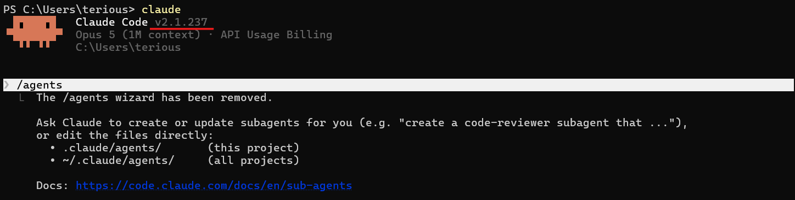

# Sub-Agent & 병렬 실행 (Sub-Agent & Parallel Execution)

## Sub-Agent란?
- 메인 Claude 안에서 <u>**별도의 작업 공간의 가진**</u> 도우미를 하나 더 띄우는 것
- 각 Sub-Agent는 자기만의 지시사항, 도구, 권한을 갖고 있으며 조사 결과는 Sub-Agent 쪽에만 남고 메인에는 요약만 돌아온다.
- **⚠️ Sub-Agent는 다른 Sub-Agent를 생성할 수 없다. 메인에서 체인으로 연결해야 한다.**

- Sub-Agent 장점
    - 병렬 처리 : 여러 작업을 동시에 실행해 전체 소요 시간 단축
    - 컨텍스트 보호 : 메인 에이전트의 컨텍스트를 오염시키지 않음
    - 전문화 : 각 Sub-Agent에 전문 역할 부여
    - 재사용 : 한 번 만든 Sub-Agent를 여러 워크플로우에서 활용

#### Do's
- 독립적인 작업을 병렬로 분배
- 명확한 역할과 범위 지정
- 결과를 메인에서 통합 처리

#### Don'ts
- 의존성 있는 작업을 무리하게 병렬화
- 하나의 Sub-Agent에 너무 많은 역할
- Sub-Agent 간 직접 통신 시도(불가)

## 내장 Sub-Agent 5종
| Sub-Agent | 모델 | 권한 | 용도 |
| --- | --- | --- | --- |
| Explore | Haiku (빠름) | 읽기 전용 | 코드 탐색, 파일 검색, 구조 파악 |
| Plan | 상속 | 읽기 전용 | Plan Mode에서 계획 수립 연구 |
| General-purpose | 상속 | 모든 도구 | 탐색 + 수정 필요한 복잡한 다단계 작업 |
| Bash | 상속 | Bash만 | 별도 컨텍스트에서 터미널 명령 실행 |
| Claude Code Guide | Haiku | 읽기 전용 | Claude Code 기능 질문 답변 |

## 커스텀 에이전트 만들기
1. `/agents` 입력
2. Create new agent 선택
3. User-level(모든 프로젝트) 또는 Project-level(현재 프로젝트만) 선택
4. Generate with Claude 선택 → 에이전트 설명 입력
5. 도구 선택(Read-only / 전체 도구)
6. 모델 선택(Sonnet, Opus, Haiku, 상속)
7. 배경색 선택 → 저장 → 즉시 사용 가능
- ⚠️ v2.1.198 이후 `/agents` 명령어 사라짐


```md
ex) # 에이전트 파일 구조 (YAML + Markdown)
---
name: code-reviewer
description: "코드 리뷰 전문가. 품질, 보안, 모범 사례를 검토."
tools: Read, Grep, Glob, Bash
model: sonnet
---

호출되면:
1. git diff로 최근 변경 확인
2. 수정된 파일에 집중하여 리뷰

피드백 우선순위:
- 🔴 크리티컬 (반드시 수정)
- 🟡 경고 (수정 권장)
- 🟢 제안 (개선 고려)
```

## 에이전트 저장 위치 & 범위
| 어디에 저장? | 어디에 쓸수 있나? | 언제 이렇게 쓰나? |
| --- | --- | --- |
| `~/.claude/agents/` | 내 모든 프로젝트에서 사용 가능 | 나만 쓰는 개인용 에이전트 |
| `.claude/agents/` | 이 프로젝트에서만 사용 가능 | 팀과 공유할 프로젝트 전용 |
| 플러그인의 `agents/` | 플러그인 활성화된 곳에서만 | 플러그인 제공 에이전트 |
| `--agents` CLI 플래그 | 지금 이 세션에서만(일회용) | 자동화 스크립트/CI에서 즉석 사용 |

```Bash
# ex) CLI에서 즉석으로 에이전트 정의 (일회성)
claude --agents '{
  "quick-reviewer": {
    "description": "빠른 코드 리뷰어",
    "prompt": "변경된 코드를 리뷰하고 핵심 이슈만 보고하세요.",
    "tools": ["Read", "Grep", "Glob"],
    "model": "haiku"
  }
}'
```

## 실전 패턴
- 대량 출력 격리 : 테스트/로그 분석처럼 출력이 많은 작업을 위임하고 요약만 받기
- 병렬 연구 : 독립적인 모듈을 각각 별도 Sub-Agent로 동시 분석
- 에이전트 체인 : code-reviewer → optimizer 순서로 순차 연결 
- 에이전트 재개 : 완료 후에도 이전 컨텍스트를 유지한 채 이어서 작업 가능

## Sub-Agent vs 메인 대화 판단 기준
| 판단 질문 | Yes → 추천 | No → 추천 |
| --- | --- | --- |
| 작업이 독립적인가? | Sub-Agent(결과만 받으면 됨) | 메인 대화(왔다 갔다 추천) |
| 컨텍스트 오염 우려? | Sub-Agent(대량 출력 격리) | 메인 대화(가벼우면 분리 불필요) |

- 직접 하기 vs 심부름 시키기
- 간단한 건 직접, 시간이 오래 걸리는 건 심부름 시키고 결과만 받기